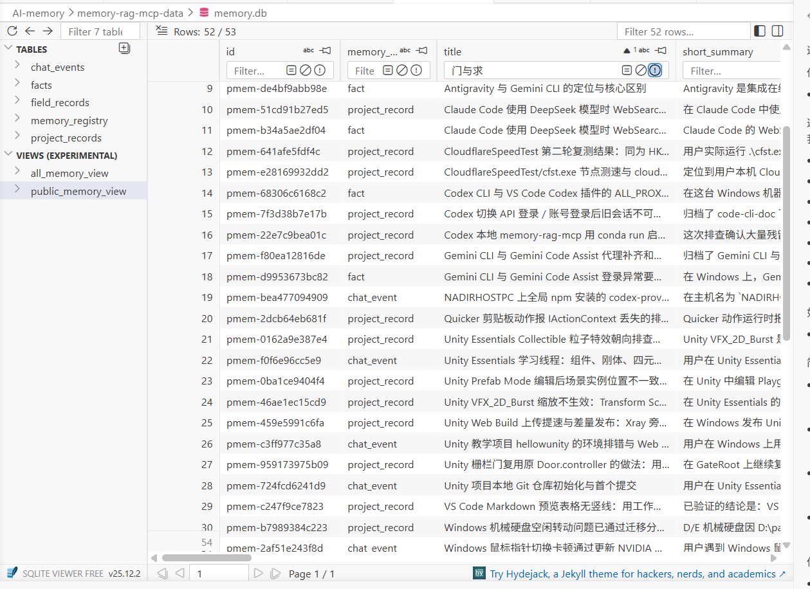

# 项目说明

当前项目名是 `memory-rag-mcp`。这个目录里放的是一个独立的 Python MCP server，用来保存高信息密度的项目经验、会话事件和事实记忆，生成按最近更新时间整理的时间线，并支持向量相似度检索。

## 运行方式

- 服务入口：`AI-memory/memory-rag-mcp/server.py`
- 项目配置：`AI-memory/memory-rag-mcp/config/settings.yaml`
- 传输方式：`stdio`

## 文档导航

| 需要了解什么 | 阅读位置 |
| --- | --- |
| 部署、配置、数据位置及写接口 | 本 README |
| 搜索评分、消息选择、详情读取和调用边界 | [检索与详情接口契约](docs/retrieval-api.md) |
| 核心服务的数据读取分工及归档 Agent 自由查库边界 | [数据读取说明](docs/storage-access.md) |
| 本次优化、接口变化、验证及升级范围 | [2026-10-29 变更说明](docs/changes-2026-10-29.md) |
| AI 调用时能看到的简短约定 | `server.py` 的工具和参数描述，通过 MCP 工具列表暴露 |

检索与详情的完整契约集中维护在 `docs/retrieval-api.md`；下面仅保留速查，避免多份详细文档各自演化。行为变更需同步文档、工具描述和对应测试，不能只改客户端缓存。

## 项目特点

**SQLite 作为主数据来源接入**
当前几种类型的记忆使用 `SQLite` 分表存储。
`save / update / delete / get_details / timeline` 这几条接口链路不再依赖把整库 JSON 读进内存，而是按 `id`、`source_memory_id` 和稳定排序去查 `memory.db`。
当前 `memory.db` 内部已经改成分表结构：轻总表 `memory_registry`(存放各个记忆类型分表的公开信息字段作为分表索引)、三张类型详情表和一张 `field_records` 表，不再是早期单表 `memory_entries`。
 rag （向量检索）侧仍然保留 `memory_embeddings.npy`、`memory.faiss` 和 `meta_NpyRow-to-id.json`。新增、更新、删除时，主数据先按行写入 `SQLite`，再尽量复用旧向量缓存做增量刷新；只有缓存不再安全可复用时，才退回后台全量重建。

**多种记忆类型**
使用方面，不只存一种记忆，而是根据个人实际使用情况不断长期测试，明确分成 project_record、chat_event、fact 三种公共记忆类型，分别对应项目归档、普通会话事件（侧重时间切片）、自动提取的长期事实。

**field_record 内部记忆类型**
该记忆类型不作为返回，仅为了提升召回，在 save 时由服务端自动拆分记忆的每个字段分别存储一遍，并且 search 调用时不会返回给用户
**目的**：为了解决**粒度不一致**的问题（比如单条记忆太大 quary 太小）导致检索漏关键信息
**字段描述**：在每一条记忆详细入库之后，也顺便把该条记忆中真正参与拆分的字段单独存成`field_record`。当前物理表只保留 `source_memory_id`、`source_field_name`、`source_field_value_text`、`source_field_value_json`、`created_at`、`updated_at` 这些最小必要字段。

**本地 embedding 缓存和增量更新**
在性能上重点做了“少重复 embedding”。这里具体指：优先走本地 embedding 缓存和增量更新，只有缓存失效或条件不满足时才退回后台全量重建。

它的运行参数不是散在环境变量里，而是统一收口在 config/settings.yaml。这里具体指：server、paths、embedding、memory、summary、search、retrieval、results 都在一份 YAML 里管理。

**项目归档分表优化**（建设中
project 分为项目索引表和项目child表，实现了同项目下一个问题归档为一条记录，避免了一个项目一个表项条目所导致的token爆炸和总结质量低下的问题

**检索文本(记忆中真正向量化的字段)**
对应字段：retrieval_fields_json
retrieval_fields_json 保留，但它仍然只是内部字段名单，不是新的业务信息。
这里具体指：它记录“这条记录哪些字段要拼进 embedding 文本”, 供 build_retrieval_text(...) 使用。
project_registry 真正参与检索文本的字段固定为：
- title
- overview_summary
- tags
project_id 不进检索文本。
这里具体指：新创建的 `project_registry.id` / `project_id` 统一用 `projRegId-*`；历史上的 `proj-*`、`projRegisterMemId-*` 仍然允许继续被 `save_project` 挂载。
created_at、updated_at、reference_doc_path、source_paths 不进检索文本，避免时间和路径噪声污染召回。
project_registry 不再要求调用方传 short_summary；如果统一返回结构仍需要 short_summary，就在服务端基于 overview_summary 自动生成一个兼容值，不单独落库。
(待优化，返回结构不应该由接口限制，毕竟记忆的字段都已经是服务端定好的，遵循严入宽出的原则)


## 项目配置文件

- 不再通过环境变量覆盖模型路径和设备。
- 运行参数统一放在：`AI-memory/memory-rag-mcp/config/settings.yaml`
- 这份 YAML 里已经按类别收好了：
  - `server`
  - `paths`
  - `embedding`
  - `memory`
  - `summary`
- `search`
  - `retrieval`
  - `results`
- 代码启动时会直接读取这份 YAML，并把它收口成当前运行常量。
- `search.min_similarity`
  - 可填 `null` 或 `0.0` 到 `1.0` 的数值；默认 `null`，表示关闭最低相似度过滤。
  - 开启后，服务端先把多个向量命中折叠到主记忆并取最高分，再按 `score >= min_similarity` 过滤，最后执行 `top_k` 截取，因此返回数量可能少于 `top_k`。
  - 修改后需要重启 MCP；该配置只影响结果裁剪，不改变向量文本、FAISS 或索引签名，也不需要重建索引。
- `search.message_score_gap` 默认 `0.2`，必须为非负有限数，控制同一聊天记录内的消息命中分差。
- `search.message_top_k` 默认 `3`，必须为正整数，限制每条聊天记忆的代表消息数；`search` 可单次覆盖，省略或传 `null` 使用配置值。
- `results.returnMessageNum` 默认 `10`，必须为非负整数，表示命中消息前后各扩展的消息条数。
- 已取消详情固定 40 条上限；旧配置的 `results.max_total_messages` 即使残留也不再读取或生效。
- 缺少上述新增配置时使用默认值；修改后重启所有相关 MCP 进程生效，不改变切片、向量或索引签名，无需数据迁移或索引重建。
- 消息按 `messages` 数组中的单条记录计数，不按一问一答计数；这些配置不限制单条消息长度或整批响应的字符/token 数。

## 项目 Requirements
如果你准备 clone 这个仓库并在自己的机器上继续使用，最少需要先看清两类东西：
1.代码仓库里会带什么 2.哪些私有资产需要你自己准备或接回本地。

### 运行环境约束

- 操作系统：`Windows x64`。其他系统当前没有完成现场验证。
- Python：限定为 `3.10 x64`。当前完整验证环境是 Conda 提供的 `3.10.19`；Python.org 不提供该补丁版本的 Windows 安装器，新部署可使用最后一个带官方 Windows 安装器的 [`3.10.11`](https://www.python.org/downloads/release/python-31011/)。
- 推理设备：当前按 `CPU` 建库和检索；本仓库不提供 CUDA 环境配置保证。
- Python 包：以 `requirements.txt` 的精确版本为准，不提交或分发本机生成的 `.venv`。

### clone 仓库后即可获得的内容

- `memory-rag-mcp/` 项目代码
- `config/settings.yaml`
- `requirements.txt`
- `README.md`

其中：

- `config/settings.yaml` 的位置固定就是项目内的 `config/settings.yaml`
- clone 完成后，在项目根目录创建自己的 `.venv`，再按 `requirements.txt` 安装依赖；具体命令见下方“部署流程”

### 私有资产（不会随仓库自动带上）

- 本地 embedding 模型目录
  - 实际位置由 `config/settings.yaml` 里的 `embedding.model_path` 决定
  - 如果想保留回退能力，再额外准备一个可切换的回退模型目录
- 私有记忆数据目录
  - `AI-memory/memory-rag-mcp-data/`
  - 如果要延续旧记忆，里面至少应包含：
    - `memory.db`
    - `memory_embeddings.npy`
    - `memory.faiss`
    - `meta_NpyRow-to-id.json`
- 人类视图文件
  - `AI-memory/memory-rag-mcp-data/RAG记忆库时间线.md`
  - 这个文件不是主数据源，但建议跟数据目录一起接回，避免换机后丢失人类可读视图
- Codex 本地注册配置
  - 新机器上的 `C:\Users\<你的用户名>\.codex\config.toml` 里需要注册 `memory-rag-mcp`
  - 推荐把 `command` 直接指向目标 Python 环境里的 `python.exe`，再用 `args = ["-u", "<server.py 路径>"]` 启动
  - 这样少一层 `conda run -> cmd/bat -> python` 包装，后面排查残留进程时更容易看清到底是哪一个脚本在运行

### 两种使用模式

- 空库启动模式
  - 只接代码和本地模型，不接旧数据
  - 这种情况下也可以直接开始 `save`
  - 首次保存后，服务会自动生成 `memory.db`、时间线、embedding 缓存、FAISS 和 meta
- 旧记忆延续模式
  - 在上面的基础上，再把私有模型和私有记忆数据接回本地
  - 这样 `search` 才能直接命中历史 AI 记忆

部署时最容易漏掉的不是代码，而是下面三样：

- 本地 embedding 模型目录
- `memory-rag-mcp-data/` 里的私有记忆数据文件
- Codex 的 MCP 注册块（推荐 direct python）

## 记忆文件位置

- `AI-memory/memory-rag-mcp-data/memory.db`
- `AI-memory/memory-rag-mcp-data/memory_embeddings.npy`
- `AI-memory/memory-rag-mcp-data/memory.faiss`
- `AI-memory/memory-rag-mcp-data/meta_NpyRow-to-id.json`
- `AI-memory/memory-rag-mcp-data/RAG记忆库时间线.md`

其中：

- `memory-rag-mcp-data/` 目录承载项目记忆系统自己的数据和索引文件，避免把技术文件散落在 `AI-memory` 根目录。
- `memory.db`
  - 当前唯一主数据源，保存各个记忆的完整内容。
  - 当前库内结构是：`memory_registry`、`project_records`、`chat_events`、`facts`、`field_records`。
- `memory_embeddings.npy`
  - 一张原始向量表，即已计算向量的本地缓存矩阵文件，用来减少重复 embedding。实现增量 embedding
- `memory.faiss`
  - 该文件是可直接加载查询的 Flat-IP 索引对象，即建库时读取 .npy 做出来的搜索结构/检索目录/索引对象，查询就查它
  - FAISS 在 search 是直接读取复用该文件，而不是 .npy 文件
- `meta_NpyRow-to-id.json`
  - 索引配套元数据，主要记 3 类东西：用了哪个 embedding 模型、检索字段签名、FAISS 行号到记录 id 的映射。
- `RAG记忆库时间线.md`
  - 放在 `memory-rag-mcp-data/` 目录中，给人看的时间线视图，按最近更新时间整理，不是主数据源。

# 接口描述

## 调用约定

- 这些接口面向已经整理好的结构化输入，不负责替调用方阅读原始 Markdown、日志或网页。
- 调用 `save` / `update` 前，应先把内容整理成结构化字段；如果用户指定了现成文档，应先阅读文档，再提取并补充结构化信息。
- `project_record` 和 `fact` 使用 `detailed_summary` 作为正式正文；`chat_event` 使用结构化 `raw_dialogue` 保存完整对话，并从其中派生消息级检索记录。
- 当前不接受外部传业务时间字段；`created_at` 和 `updated_at` 都由服务端自动维护。
- `memory.db` 是唯一事实源；向量索引、时间线和内部 `field_record` 都是基于主数据生成的衍生产物。
- 当前 SQLite 主数据采用分表结构：轻总表负责路由，`project_record / chat_event / fact` 各自有详情表，`field_record` 独立成最小必要字段表。

## 接口总览

- `save`
  - 作用：保存一条高信息密度的项目经验、会话事件或事实记忆。
  - 副作用：更新 `SQLite` 主数据、重写时间线 Markdown，并优先复用本地 embedding 缓存来刷新向量索引。
- `save_chatEvent`
  - 作用：专门保存一条 `chat_event` 会话事件记忆。
  - 返回方式：固定按 `chat_event` 新事件写入，返回字段与现有 `save` 一致，不自动回写旧事件。
- `update`
  - 作用：按 `id` 更新一条已有记忆。
  - 返回方式：补丁式修改原类型下的主数据字段；通过校验后写回主数据，并刷新受影响索引。当前不再用 `update` 做记忆类型切换。
- `search`
  - 作用：按向量相似度检索最相关的历史记忆候选。
  - 返回方式：先查 `FAISS`，再按命中 id 回源 `SQLite` 主数据，只返回轻量候选字段和相似度分数；如果命中的是内部字段级子记忆，会先折叠回源到主记忆。
- `get_details_by_ids`
  - 作用：按一批记录 `ids` 读取详情；聊天默认返回只读上下文，全文需传 `full_dialogue=true`。
  - 返回方式：直接按 `id` 回源 `SQLite` 主数据，统一返回 `records` 列表和 `missing_ids`。
- `delete_by_ids`
  - 作用：按一批记录 `ids` 从主数据中硬删除记忆。
  - 返回方式：删除命中的记录、同步更新时间线，并基于本地 embedding 缓存重建向量索引后返回最小删除结果。

## 分表迁移

- 当前版本不再兼容旧单表 `memory_entries` 直接启动。
- 如果你的 `memory.db` 还是旧单表结构，先停掉 MCP，再运行：
  - `python scripts/migrate_split_tables.py`
- 脚本会先备份当前数据库为 `memory.pre_split_tables.backup.db`，再把旧单表记录拆到：
  - `memory_registry`
  - `project_records`
  - `chat_events`
  - `facts`
  - `field_records`
- 迁移完成后，新代码才会继续正常启动。
- schema v3 的分表库会在首次访问时自动升级到 v4：为 `chat_events` 增加 `raw_dialogue`，并把旧 `detailed_summary` 原样复制过去。旧物理列保留兼容，但不再属于 `chat_event` 的接口字段。

## `save` 接口

### 功能说明

- 用于把 AI 已经整理好的结构化记忆写入长期库。
- `save` 不做“读文档并理解”的工作；那部分是 AI 在调用前完成的。
- 服务端不会替调用方判断内容真假；调用方应先完成证据确认和内容整理，再提交入库。
- 正式入库内容只允许包含已验证的事实、用户明确实践过的操作，或能被文件、截图、日志、命令输出直接证明的结论；不得补写未经验证的推测、归因或建议。
- 如果已有相似且已验证的内容，优先融合进已有记录或本次更新，不要重复堆新的近似表述。
- 每次 `save` 成功后，都会同步刷新时间线和向量索引；当前实现会优先只对新记录做增量 embedding。
- 如果缓存缺失或当前库状态无法安全复用旧向量，服务端会先写入主数据，再把全量 embedding 放到后台执行，并返回一个 `rebuilding` 提示；这段时间 `search` 不可用。
- 一般 ai 的调用流程如下：
  1. 如果本次要存的是非事件记忆，先 `search` 看看是否已有与当前主题相近的记忆。
  2. 如果已存在相近记忆，优先判断是否应该对已有记忆执行 `update`。
  3. 如果不存在合适的已有记忆，再调用 `save` 新建一条记忆。
  4. 每次 `save` 或 `update` 之后，再判断这条记忆里是否真的包含长期可复用、跨会话稳定、对长期陪伴有帮助的事实；只有确实存在这类事实时，才考虑继续按 `fact` 流程处理：先 `search` 相近 `fact`，若已有语义相近 `fact` 则优先 `update`，若没有相近 `fact` 则再 `save` 新 `fact`。如果内容主要是项目问题的排查、调试和解决过程，而 `project_record` 已经完整记录，则通常不需要再额外提取 `fact`。
- 上面的流程是推荐使用策略，不是当前服务端自动执行逻辑。

### 输入字段

- `memory_kind`
  - 必填。
  - 记忆类型。
  - 允许值：
    - `project_record`：项目经验类记录，重点记录已经解决的问题和可复用思路。要写清问题是什么、为什么这样判断、怎么解决、验证结果是什么；不要记流水账，默认应记录已经解决的问题与思路，而不是半成品过程日志。
    - `chat_event`：会话事件记忆，适合保存会话中的片段性、情境性、带时间顺序的事件痕迹。一般没有特殊说明，都作为一般事件类型存储。
    - `fact`：稳定事实记忆，以个人长期事实为主，更适合保存个人信息、长期偏好、稳定约束、长期状态、最近目标、已确认关系共识这类跨会话可复用事实。不建议把 `project_record` 里已经完整记录的项目 debug 过程、排错流水和解决链路再重复存成 `fact`；只有当项目内容被提炼成真正稳定、可跨会话复用的规则时，才考虑转成 `fact`。
- `title`
  - 必填。
  - 记录标题，用一句话概括本次记忆。
  - 只写已验证事实、用户明确实践过的操作，或有直接证据支撑的结论；不要补写未经验证的推测、归因或建议。
- `short_summary`
  - 必填。
  - 面向嵌入检索的简短摘要，建议控制在一两句话内。
  - 这个字段由 AI 主动总结，放在 `retrieval_fields` 的第二位，优先服务于 512 token 预算下的检索命中率。
  - 内容只应来自已验证事实、用户明确实践过的操作，或有直接证据支撑的结论；如果与已有已验证内容相似，优先融合整理，不要重复新编近似说法。
- `detailed_summary`
  - `project_record` 和 `fact` 必填；`chat_event` 不再接收该字段。
  - AI 整理后的最终详细总结，也是正式入库正文。
  - 这个字段默认不参与 embedding 拼接，主要用于详情阅读和长期归档。
  - 如果用户指定了参考文档，这里的信息不能比参考文档更少。
  - 只允许写入已验证事实、用户明确实践过的操作，或能被文件、截图、日志、命令输出直接证明的结论，不得补写未经验证的推测、归因或建议。
- `raw_dialogue`
  - 仅 `chat_event` 必填。
  - 新写入必须是 `{schema_version: 1, messages: [...], metadata?: {...}}` 对象；每条消息只允许 `user` 或 `assistant` 角色，并包含非空 `content`。
  - 主字段只保存在 `chat_events`，不直接进入主记忆 `retrieval_fields`；每条消息会按 token 切片派生内部 `field_record`，其正文会进入向量检索。
  - 历史字符串继续原样读取，暂不自动拆分或迁移。
- `problem_background`
  - `project_record` 必填，其他类型可选。
  - 用于保存问题以及背景、故障现象，以及这条已解决问题为什么值得记录；不要写成流水账。
  - 只写已验证事实、用户明确实践过的操作，或有直接证据支撑的结论；如果与已有已验证内容相似，优先融合整理。
- `analysis`
  - `project_record` 必填，其他类型可选。
  - 用于保存已证实的原因判断、取舍依据和排查结论，以及为什么这样判断、为什么这么做；要留下后续可复用的思路。
  - 这里只允许写入已验证事实、用户明确实践过的操作，或能被文件、截图、日志、命令输出直接证明的结论；不要写怀疑方向、猜测性归因或未证实判断。
- `action_steps`
  - `project_record` 必填，其他类型可选。
  - 用于保存真正解决问题时执行的关键步骤、命令、操作顺序或具体处理动作，不要堆无用流水过程。
  - 只写用户明确实践过的操作，或有文件、截图、日志、命令输出可直接证明的动作和结果；不要补写未经实践的建议性步骤。
- `validation_result`
  - `project_record` 必填，其他类型可选。
  - 用于保存测试、验证、复现是否消失、验收结果等验证结论；默认应记录已经解决并验证过的问题。
  - 这里只写已验证结果或能被文件、截图、日志、命令输出直接证明的结论；不要补写未经验证的判断。
- `tags`
  - 可选传入，但最终存储必有。
  - 推荐由 AI 先生成标签数组。
  - 如果缺失，服务端会做基础兜底补全。
- `source_paths`
  - 可选。
  - 普通来源材料路径或链接列表，例如日志、网页、截图、工单链接。
- `reference_doc_path`
  - 可选。
  - 参考文档路径。
  - 只在“用户指定一份现成文档让 AI 归档”时使用，不与 `source_paths` 混用。

### 返回字段

- `id`
  - 本条记录的稳定唯一标识。
  - `project_registry` 新记录使用 `projRegId-*`；历史兼容格式还有 `proj-*`、`projRegisterMemId-*`；`project_record` 使用 `projMemId-*`。
- `updated_at`
  - 最近一次入库或更新的时间。
- `created_at`
  - 第一次入库时间。
- `tags`
  - 最终落库标签数组。
- `total_entries`
  - 当前主库总记录数。
- `timeline_summary`
  - 最近几条时间线摘要，便于调用方快速确认入库结果。
- `index_stats`
  - 本次索引重建统计信息。
  - 当前包含：
    - `count`：索引中的记录条数。
    - `dim`：向量维度。
- `index_refresh_state`
  - 仅在这次写入已经接受、但索引仍在后台重建时返回。
  - 当前固定值为 `rebuilding`。
- `index_refresh_mode`
  - 仅在后台重建时返回。
  - 当前固定值为 `background_full_rebuild`。
- `index_refresh_reason`
  - 仅在后台重建时返回。
  - 说明触发全量重建的机器可读原因，例如 `cache_unavailable`、`signature_mismatch`、`missing_ids` 或 `payload_invalid`。
- `missing_entry_count`
  - 仅在存在未对齐索引 ID 时返回，表示检测到的缺失数量。
- `search_available`
  - 仅在后台重建时返回。
  - `false` 表示主数据已写入，但 `search` 需要等后台重建完成后才能继续使用。
- `message`
  - 仅在后台重建时返回。
  - 用于提示调用方：主数据已经写入，但索引仍在后台补齐。
### `save` 的核心字段

- `memory_kind`
  - 必填。
  - 只能是 `project_record`、`chat_event` 或 `fact`。
- `title`
  - 三类公共记忆都必填。
- `short_summary`
  - 最终存储必有。
  - 三类公共记忆都必填。
  - 用来保存面向嵌入检索的简短摘要，建议控制在一两句话内。
  - 这个字段需要 AI 主动总结，不再由服务端为新记录自动补造。
- `detailed_summary`
  - `project_record` 和 `fact` 必填；`chat_event` 不包含该字段。
  - 这是 AI 整理后的最终详细总结，也是正式入库字段。
  - 默认不会进入 embedding 检索文本，主要保留给详情读取和长期归档。
- `raw_dialogue`
  - 仅 `chat_event` 必填，用于完整对话回源。
  - 主字段本身不参与 embedding；其中的结构化消息会派生内部 `field_record` 并参与 embedding。
- `problem_background`、`analysis`、`action_steps`、`validation_result`
  - `project_record` 必填。
  - `fact` 可为空；`chat_event` 不再包含这些字段。
  - `problem_background` 用来保存“问题以及背景”，而不只是一个简短问题名。
  - `analysis` 用来保存原因判断、方案分析、排查结论，以及为什么这么做。
  - `action_steps` 用来保存实际执行的步骤、命令、操作顺序或具体处理动作。
  - `validation_result` 用来保存测试、验证、复现是否消失、验收结果等验证结论。
- `updated_at`
  - 由服务端自动维护。
  - 表示该记录最近一次入库或更新的时间。
- `created_at`
  - 由服务端自动维护。
  - 表示该记录第一次入库的时间，写入后不再变化。
- `tags`
  - 最终存储必有。
  - 推荐由 AI 先生成；缺失时服务端会做基础兜底补全。
- `source_paths`
  - 普通来源材料列表，比如日志、网页、截图来源。
- `reference_doc_path`
  - 参考文档路径。
  - 只在“用户指定现成文档让 AI 入库”时填写，不与 `source_paths` 混用。

### 个人笔记

save：先规范化新记录，读老主数据进内存，然后拼接成新主数据列表，然后按照脚本规则进行排序，此时内存中有了最新的主数据  
然后取meta里的id列表，并和缓存矩阵构成一个 dict【id->向量】:  
-- 从 cached_embeddings + cached_row_ids 生成 cached_vector_by_id

然后向量化新记录并把新向量补进字典:  
-- cached_vector_by_id[appended_entry_id] = appended_embedding

然后脚本根据这个 dict 以及新主数据的 id 顺序（current_entry_ids ），按最新顺序重拼并落盘新faiss、meta和npy：  
memory_embeddings.npy <- rebuilt_embeddings  
memory.faiss <- 基于 rebuilt_embeddings 重建  
meta_NpyRow-to-id.json <- sorted_entries 中真正有检索文本的 id 顺序
这个 meta 文件里还会保存 `embedding_model_fingerprint`，只用于校验当前索引是不是由同一个 embedding 模型目录生成。  

## `save_chatEvent` 接口

### 功能说明

- 专门用于保存一条 `chat_event` 会话事件记忆。
- 适合保存会话中的片段性、情境性、带时间顺序的事件痕迹。
- 默认策略是新存，不因为主题相近、人物相近或问题相近，就自动合并旧 `chat_event`。
- 只有在补充刚写入不久的同一事件，或纠正原记录事实错误时，才应优先考虑对旧 `chat_event` 执行 `update`。
- 服务端不会替调用方判断内容真假；调用方应先完成证据确认和内容整理，再提交入库。
- 正式入库内容只允许包含已验证的事实、用户明确实践过的操作，或能被文件、截图、日志、命令输出直接证明的结论；不得补写未经验证的推测、归因或建议。
- 返回字段与现有 `save` 完全一致，不新增专属返回字段。

### 输入字段

- `title`
  - 必填。
  - 事件标题，用一句话概括这次会话事件。
  - 只写已验证事实、用户明确实践过的操作，或有直接证据支撑的结论；不要补写未经验证的推测、归因或建议。
- `short_summary`
  - 必填。
  - 面向嵌入检索的简短摘要，建议控制在一两句话内。
  - 这个字段由 AI 主动总结，放在 `retrieval_fields` 的第二位，优先服务于 512 token 预算下的检索命中率。
  - 内容只应来自已验证事实、用户明确实践过的操作，或有直接证据支撑的结论；如果与已有已验证内容相似，优先融合整理，不要重复新编近似说法。
- `raw_dialogue`
  - 必填。
  - 必须传结构化对象；`messages` 为非空数组，每项包含 `role` 和 `content`，可选 `message_id`、`timestamp`、`metadata`。
  - `role` 只允许 `user`、`assistant`；服务端规范换行和边界空白，但不做语义去重。
  - 主对象完整写入 SQLite；消息正文按 `retrieval.chat_event_chunk_max_tokens` 与当前模型 token 上限切片，分别生成 `field_record`。
- `tags`
  - 可选传入，但最终存储必有。
  - 推荐由 AI 先生成标签数组。
  - 如果缺失，服务端会做基础兜底补全。
- `source_paths`
  - 可选。
  - 普通来源材料路径或链接列表，例如日志、网页、截图、工单链接。
- `reference_doc_path`
  - 可选。
  - 参考文档路径。
  - 只在“用户指定一份现成文档让 AI 归档”时使用，不与 `source_paths` 混用。

### 返回字段

- 与现有 `save` 完全一致。

## `update` 接口

### 功能说明

- 用于按记录 `id` 对一条已有记忆做补丁式更新。
- `update` 不是整条记录替换；`changes` 里传什么字段，就只更新什么字段。
- `changes` 中新增或替换的内容，只允许包含已验证的事实、用户明确实践过的操作，或能被文件、截图、日志、命令输出直接证明的结论；不要把未验证的推测、归因或建议补进已有记录。
- 如果只是补充已有相似且已验证的内容，优先融合到原记录，而不是制造重复表达。
- 通过校验后，接口会按当前类型把这次变更写回主数据，并刷新 `updated_at` 与受影响索引。
- 当前实现会优先只重算被更新主记忆本体，以及本次受影响字段对应的 `field_record` 子记录向量。
- 如果缓存缺失或当前库状态无法安全复用旧向量，服务端会先写入主数据，再把全量 embedding 放到后台执行，并返回一个 `rebuilding` 提示；这段时间 `search` 不可用。
- `field_record` 属于内部索引资产，不能通过 `update` 直接修改。
- `update` 不再允许修改 `memory_kind`；如果要把 `chat_event` 改成 `project_record`，应重新整理内容后调用 `save` 新存，必要时再调用 `delete_by_ids` 删除旧记录。

### 输入字段

- `id`
  - 必填。
  - 要更新的目标记录 id。
- `changes`
  - 必填。
  - 一个补丁对象，只传本次要修改的业务字段。
  - 传入的业务字段值只应包含已验证事实、用户明确实践过的操作，或能被文件、截图、日志、命令输出直接证明的结论；不要把未验证的推测、归因或建议写成更新内容。
  - 如果与原记录或其他已有记录中的已验证内容相似，优先融合整理，不要重复补一条近似说法。
  - 允许字段包括：
    - `title`
    - `short_summary`
    - `raw_dialogue`（仅 `chat_event`）
    - `detailed_summary`
    - `problem_background`
    - `analysis`
    - `action_steps`
    - `validation_result`
    - `tags`
    - `source_paths`
    - `reference_doc_path`
  - `chat_event` 不允许修改 `detailed_summary`；更新 `raw_dialogue` 时必须提交完整结构化对象，服务端会整体替换该会话的消息级 `field_record`。
  - 如果需要切换记忆类型，不要把 `memory_kind` 塞进 `changes`；应改为调用 `save` 新建正确类型，再按需要删除旧记录。
  - 不允许直接修改：
    - `id`
    - `created_at`
    - `updated_at`
    - `retrieval_fields`
  - 清空语义：
    - 可空文本字段用 `null` 清空
    - `source_paths` 用 `[]` 清空
    - `tags` 传 `[]` 时仍沿用当前服务端兜底补标签规则，最终结果不保证为空
    - 空字符串按真实值处理，不自动当清空

### 返回字段

- `id`
  - 本条记录的稳定唯一标识。
- `updated_at`
  - 最近一次真实内容变化时间。
- `created_at`
  - 第一次入库时间。
- `tags`
  - 更新后的最终标签数组。
- `updated`
  - 是否真的发生了更新。
  - 当前成功写回时固定为 `true`。
- `total_entries`
  - 当前主库总记录数。
- `timeline_summary`
  - 最近几条时间线摘要。
- `index_stats`
  - 当前索引统计信息。
- `index_refresh_state`
  - 仅在这次更新已经接受、但索引仍在后台重建时返回。
  - 当前固定值为 `rebuilding`。
- `index_refresh_mode`
  - 仅在后台重建时返回。
  - 当前固定值为 `background_full_rebuild`。
- `index_refresh_reason`
  - 仅在后台重建时返回。
  - 说明触发全量重建的机器可读原因，例如 `cache_unavailable`、`signature_mismatch`、`missing_ids` 或 `payload_invalid`。
- `missing_entry_count`
  - 仅在存在未对齐索引 ID 时返回，表示检测到的缺失数量。
- `search_available`
  - 仅在后台重建时返回。
  - `false` 表示主数据已更新，但 `search` 需要等后台重建完成后才能继续使用。
- `message`
  - 仅在后台重建时返回。
  - 用于提示调用方：主数据已经更新，但索引仍在后台补齐。
## `search` 接口

完整参数、字段、筛选规则和异常返回见 [检索与详情接口契约](docs/retrieval-api.md)。

- `search(query, top_k=5, message_top_k=null)` 返回轻量主记忆候选，不返回消息正文。
- `top_k` 限制主记忆数量，当前配置最多 20；`message_top_k` 限制每条聊天记忆的代表消息数，默认 3，可单次覆盖。
- 聊天结果的 `matched_messages` 提供消息 ID 和评分，`matched_message_ids` 与之严格对应；同一片上下文内不重复选取代表锚点。
- 调用者根据评分选择消息，并将主记忆 ID 和分组的消息 ID 一起交给详情接口。只传主 ID 不会自动沿用搜索定位。
- 后台重建中或失败时 `search_available=false`，不是“没有相关记忆”。相似度不是事实正确的概率，历史命中不代表当前事实。

## `get_details_by_ids` 接口

完整参数、定位失效处理、返回字段和回写保护见 [检索与详情接口契约](docs/retrieval-api.md)。接口不重新检索，也不记住上一次 `search`。

| 聊天详情请求 | 默认返回（前后半径为 10） |
| --- | --- |
| 只传主记忆 `ids` | 每条会话末尾最多 21 条预览，不是自动命中上下文 |
| 传 `ids` 和分组的 `matched_message_ids` | 各有效消息及前后各 10 条，窗口合并去重 |
| 传 `full_dialogue=true` | 原始完整对话，不添加 `context` 或省略项 |

按搜索命中读取的请求示例：

```json
{
  "ids": ["eventMemId-example"],
  "matched_message_ids": {"eventMemId-example": ["msg-100", "msg-250"]},
  "full_dialogue": false
}
```

- `ids` 是主记忆 ID；`msg-*` 必须放在所属会话的定位列表中，不能直接作为 `ids`。不能读取内部 `fmem-*`。
- 返回 `ids`、`records`、`missing_ids`。其他记忆类型保持完整详情；聊天默认视图带只读 `context`，省略项不是实际消息。
- 有效锚点完整展开；全部失效会返回标明失效的末尾预览。调用者应检查 `context.mode` 和 `unresolved_message_ids`，不要把预览当成命中证据。
- 不设固定 40 条上限。搜索默认 3 个锚点最多展开 63 条真实消息；直接传入更多锚点不受搜索限额约束，也没有单条文字或整批 token 上限。
- 默认视图即使未裁剪也不能直接回写正文。归档查重、合并和恢复必须显式请求全文并验证完整格式。

## `delete_by_ids` 接口

### 功能说明

- 用于按记录 `ids` 从主数据中硬删除记忆。
- 删除成功后，会同步刷新主数据、时间线和向量索引；当前默认基于本地 embedding 缓存重建 FAISS，不重复调用 embedding 模型。
- 如果缓存缺失或当前库状态无法安全复用旧向量，服务端会先写入主数据，再把全量 embedding 放到后台执行，并返回一个 `rebuilding` 提示；这段时间 `search` 不可用。
- 如果部分 id 不存在，接口不会整体报错，而是通过 `missing_ids` 返回缺失项。
- 这是一个简单删除接口，不做软删除、归档或恢复站。
- 推荐调用顺序是：先 `search`，再 `get_details_by_ids` 确认内容，最后再调用 `delete_by_ids`。
- `field_record` 属于内部索引资产，不能通过这个接口直接删除。

### 输入字段

- `ids`
  - 必填。
  - 要删除的记录 id 数组。
  - 即使只删一条，也要传 `ids=["pmem-xxxx"]`。
  - 通常来自 `search` 结果中的 `id`。

### 返回字段

- `ids`
  - 清洗后的请求 id 列表；重复 id 只保留首次出现的一项。
- `deleted_ids`
  - 本次实际删除成功的 id 列表。
- `missing_ids`
  - 本次请求中未找到的 id 列表。
- `deleted_count`
  - 本次实际删除成功的记录数量。
- `index_refresh_state`
  - 仅在这次删除已经接受、但索引仍在后台重建时返回。
  - 当前固定值为 `rebuilding`。
- `index_refresh_mode`
  - 仅在后台重建时返回。
  - 当前固定值为 `background_full_rebuild`。
- `index_refresh_reason`
  - 仅在后台重建时返回。
  - 说明触发全量重建的机器可读原因，例如 `cache_unavailable`、`signature_mismatch`、`missing_ids` 或 `payload_invalid`。
- `missing_entry_count`
  - 仅在存在未对齐索引 ID 时返回，表示检测到的缺失数量。
- `search_available`
  - 仅在后台重建时返回。
  - `false` 表示主数据已删除，但 `search` 需要等后台重建完成后才能继续使用。
- `message`
  - 仅在后台重建时返回。
  - 用于提示调用方：主数据已经删除，但索引仍在后台补齐。

## 内部检索字段说明

- `retrieval_fields`
  - 这是内部检索审计字段，不是 `save` 的输入参数。
  - 它说明“这条记录在服务端生成检索文本时，实际用了哪些字段参与 embedding 拼接”，主要用于排查 RAG 命中效果。
- `retrieval_fields_json`
  - 这是 `SQLite` 里保存 `retrieval_fields` 的内部列。
  - 它继续参与检索文本拼接和索引刷新，但不会通过 `get_details_by_ids` 对外返回。
- 当前主记忆默认 embedding 字段不包含 `detailed_summary` 或 `raw_dialogue`，而是优先使用 `title`、`short_summary`、`problem_background`、`analysis`、`action_steps`、`validation_result`、`tags`、`reference_doc_path`；结构化对话消息通过独立 `field_record` 进入索引。

## 当前实现特点

- `search` 会先命中 `FAISS`，再回源到 `memory.db` 返回轻量候选字段。
- 向量索引里同时包含主记忆和内部 `field_record`；`search` 命中 `field_record` 时会折叠回源到主记忆，并用 `matched_fields` 解释命中来源。
- `get_details_by_ids` 是详情读取入口；聊天默认提供只读上下文，`full_dialogue=true` 才返回可用于完整正文回写的格式。
- `get_details_by_ids` 按 id 类型直查 `project_records`、`chat_events`、`facts` 或 `project_registry`，不经过统一大宽表。
- `delete_by_ids` 会在主数据删除成功后同步更新时间线，并基于本地 embedding 缓存重建向量索引，不会重复调用 embedding 模型。
- `project_record` 和 `fact` 的 `detailed_summary` 会保留在主数据里，但默认不进入检索文本。
- `chat_event.raw_dialogue` 主对象只通过 `get_details_by_ids` 回源，不进入轻量搜索结果；但其 `user/assistant` 消息切片会同时保存为内部 `field_record` 并进入 FAISS。
- 当前索引链路已经分成四层：`SQLite` 主数据、embedding 缓存矩阵、FAISS 索引、meta 映射；优化重点是减少重复 embedding，而不是完全不重建 FAISS。
- Windows 的后台 worker 存活检测使用只读进程句柄，不使用 `os.kill(pid, 0)`，避免 Python 3.10 下检查状态时误终止重建进程。
- `fact` 走同库新类型，不单独建第二套 store/index；当前版本不做自动提纯或自动分片。
- 普通字段的 `field_record` 继续按 one-hot 形态存储；对话消息使用 `source_field_name=raw_dialogue`，并通过 `message_id + chunk_index` 生成多条稳定子记录。
- 对话切片长度由 `settings.yaml` 配置和 embedding 模型元数据共同约束；修改切片策略会改变 `field_record_derivation_signature`，旧向量缓存必须重建。
- 当前只有真正能拼出检索文本的记录才会进入 `memory_embeddings.npy`、`memory.faiss` 和 `meta_NpyRow-to-id.json`；空检索文本记录会被排除，避免把无意义空向量写进索引。
- `field_record` 会跟随主记忆自动生成、同步和删除，但不会进入时间线，也不会计入对外展示的 `total_entries`。
- 向量加载和归一化逻辑在当前目录下的 `embedding_utils.py` 中，不再依赖其他项目文件。

# 部署流程

## 模型准备与配置

部署前需要先准备本地 embedding 模型。仓库只包含代码，不附带本地模型文件。

- 默认模型来源固定为 Hugging Face 上的 `BAAI/bge-m3`。
- `embedding.model_path` 参数的意义是：**本地 embedding 模型目录**。
- clone 仓库后，需要先自行下载模型，再把这个参数改成你自己机器上的实际模型目录。
- 改完后重启 MCP 或重新加载 Codex 配置，并触发一次索引重建（比如调用一次 `save`），让新的模型生效。
- 如果个人资产原有模型与配置的模型不一致

### 模型参数速查表

| 模型名      | 下载链接                                   | 模型类型                        | 最大序列长度 | 向量维度 | 适用场景                                             | 当前定位 |
| ----------- | ------------------------------------------ | ------------------------------- | ------------ | -------- | ---------------------------------------------------- | -------- |
| `bge-m3`    | `https://huggingface.co/BAAI/bge-m3`       | 多语言 embedding 模型           | `8192`       | `1024`   | 更适合长总结、长问题背景、长操作步骤的检索           | 默认模型 |
| `m3e-large` | `https://huggingface.co/moka-ai/m3e-large` | Sentence Transformers / BERT 系 | `512`        | `1024`   | 适合较短中文语义检索；当前主要问题是长检索文本会截断 | 低性能模型 |

参数口径说明：
- `m3e-large` 的参数来自其 Hugging Face 模型配置文件。
- `bge-m3` 的参数来自其 Hugging Face 模型配置文件与官方 README。

### 使用 `bge-m3`

1. 从 `https://huggingface.co/BAAI/bge-m3` 下载模型到你的本地目录。
2. 修改 `config/settings.yaml` 里的 `embedding.model_path`，把它指向你自己的 `bge-m3` 本地模型目录。
3. 重启 MCP 或重新加载 Codex 配置。
4. 触发一次索引重建或执行一次 `save`，确认 `memory.faiss` 和 `meta_NpyRow-to-id.json` 已按新模型重建。

补充说明：建库暂时用cpu，不包含 CUDA 环境整改

### 切换到 `m3e-large`
1. 从 `https://huggingface.co/moka-ai/m3e-large` 下载模型到你的本地目录。
2. 修改 `config/settings.yaml` 里的 `embedding.model_path`，把它指向你自己的 `m3e-large` 本地模型目录。
3. 重启 MCP 或重新加载 Codex 配置。
4. 触发一次索引重建或执行一次 `save`，确认 `memory.faiss` 和 `meta_NpyRow-to-id.json` 已按回退模型重建。

补充说明：`m3e-large` 的处理信息长度相对低一些，`512 token`，对较长问题背景、分析、处理步骤这类复杂项目记录，截断风险更高。

默认使用方式：

1. clone 仓库：把 `memory-rag-mcp/` 放到你的本地工作目录
2. 确认当前命令指向 Python 3.10.x：

   ```powershell
   python --version
   ```

3. 在项目根目录创建独立虚拟环境并安装依赖：

   ```powershell
   python -m venv .venv
   .\.venv\Scripts\python.exe -m pip install --upgrade pip
   .\.venv\Scripts\python.exe -m pip install -r requirements.txt
   ```

4. 确认配置文件仍位于项目内固定位置：
   - `config/settings.yaml`
5. 如果你本地的项目目录、数据目录或时间线路径与默认布局不同，修改 `settings.yaml` 里的 `paths.*`
6. 从 `BAAI/bge-m3` 下载模型，并按上面的“模型准备与配置”完成路径修改
7. 如果只是想把项目跑起来，不接旧数据也可以，后续直接开始 `save` 即可
8. 如果想继续使用旧 AI 记忆，再把私有数据目录 `memory-rag-mcp-data/` 整体接回本地；时间线文件现在也包含在这个目录里
9. 按下方“`MCP 注册（推荐 direct python）`”完成 `~/.codex/config.toml` 注册（可以让 AI 协助生成）
10. 做一次最小校验：
   - `.\.venv\Scripts\python.exe -m py_compile server.py`
   - 再执行一次 `search` 冒烟测试，确认服务可用

## MCP 注册（推荐 direct python）

推荐直接使用目标 Python 环境里的 `python.exe` 启动 `server.py`。Windows 示例：

```toml
[mcp_servers.memory-rag-mcp]
type = "stdio"
command = "C:\\path\\to\\memory-rag-mcp\\.venv\\Scripts\\python.exe"
args = ["-u", "C:\\path\\to\\memory-rag-mcp\\server.py"]
enabled = true
```

参数说明：

- `command`
  - 指向安装好依赖（ `faiss-cpu`、`mcp`、`sentence-transformers` 等）的环境内 `python.exe`
- `args[0]`
  - `-u` 表示关闭 Python 标准输出缓冲
  - 这里具体指：`stdio` 模式下，服务端的输入输出会更直接，不容易因为缓冲区延后暴露问题
- `args[1]`
  - 指向本仓库里的 `server.py`
- `enabled`
  - 当值为 true，codex 才会实际注册并启动这个 MCP server

为什么推荐这样写：

- 不用 conda 启动方式，少一层 `conda run -> cmd/bat -> python` 包装，进程结构更简单
- 更容易把 `stdio` 会话和真正跑 `server.py` 的进程对应起来
- 后面如果任务管理器里出现很多 `python.exe`，更容易按命令行归因

## 排障备注：conda 注册方式

如果你用的是下面这种 `conda run` 写法：

```toml
[mcp_servers.memory-rag-mcp]
type = "stdio"
command = "C:\\path\\to\\miniconda3\\Scripts\\conda.exe"
args = ["run", "--no-capture-output", "-n", "<env-name>", "python", "C:\\path\\to\\memory-rag-mcp\\server.py"]
enabled = true
```

它也能用，但会由于多出 `conda-script.py run` 这一层。导致任务管理器里可能同时出现包装进程和真正的 Python 进程，后面会出现残留了一堆 `python.exe`进程的问题。这个问题暂时没解决

看到很多 `python.exe` 时，先看下面三样：

- 命令行是不是直接类似 `C:\\path\\to\\your-env\\python.exe -u C:\\path\\to\\memory-rag-mcp\\server.py`
- 命令行里有没有 `conda-script.py run --no-capture-output`
- 父进程是谁；如果父进程已经没了，但 `server.py` 还在跑，就说明本地清理没有跟上
